# Tendo - on-demand home services marketplace

Book a vetted local pro for cleaning, plumbing, electrical, handyman, moving or beauty work in a few taps: compare pros, pick a package and a time slot, check out, follow the job live, chat with the pro and leave a rating. A provider mode shows the other side of the marketplace, where a pro accepts or declines incoming jobs.

## Demo


Captured on an Android emulator. The same codebase builds for iOS and the web.

## Screenshots

| Welcome | Home | Search results | Provider profile | Book a service |
|---|---|---|---|---|
| 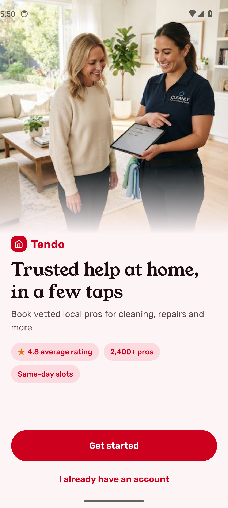 | 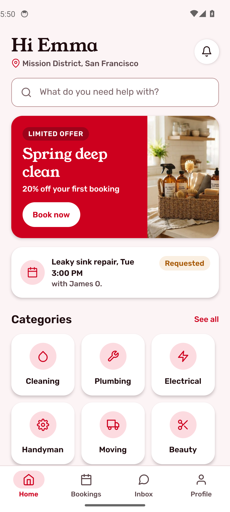 | 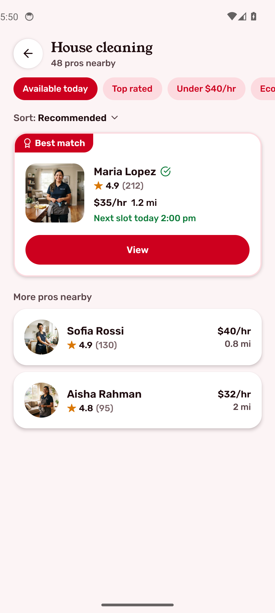 | 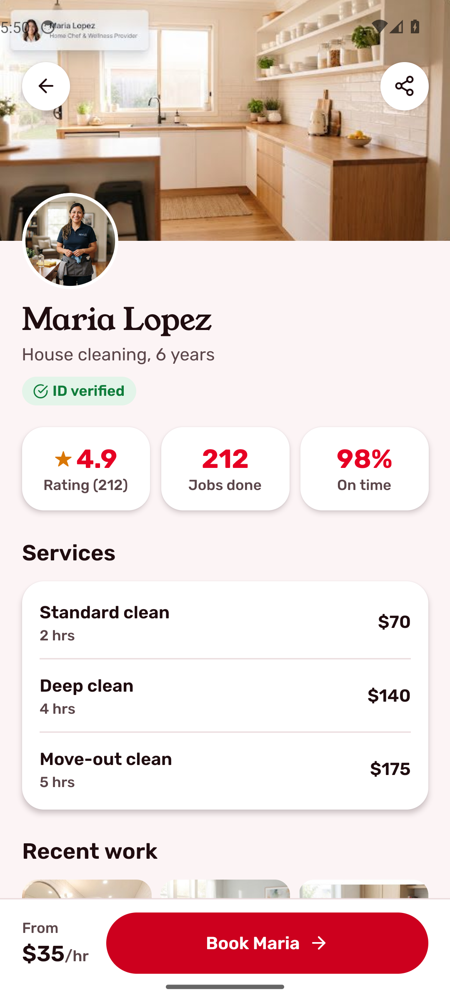 | 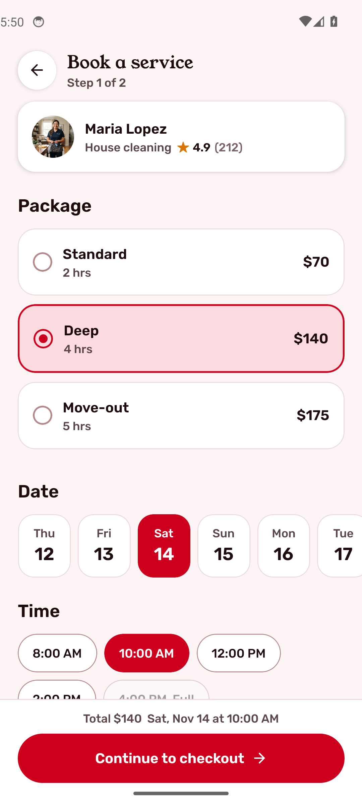 |

| Checkout | Live tracking | Chat | Bookings | Provider mode |
|---|---|---|---|---|
| 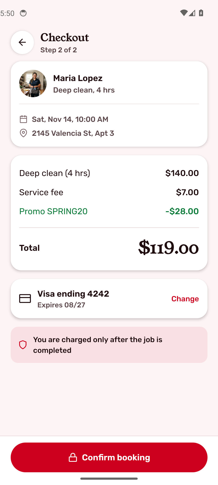 | 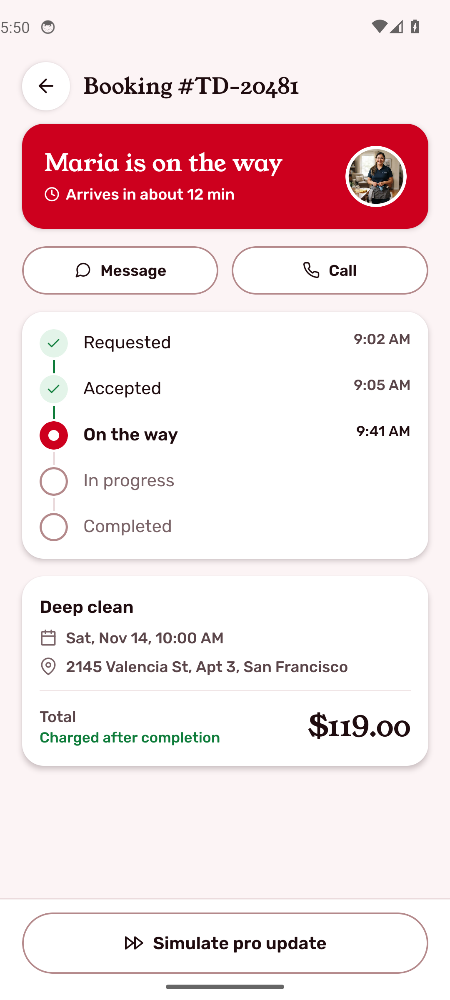 | 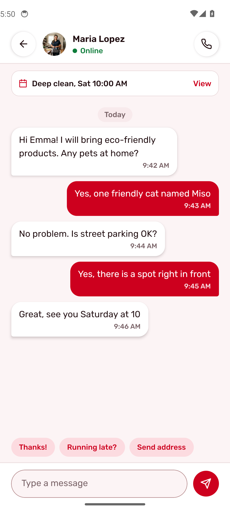 | 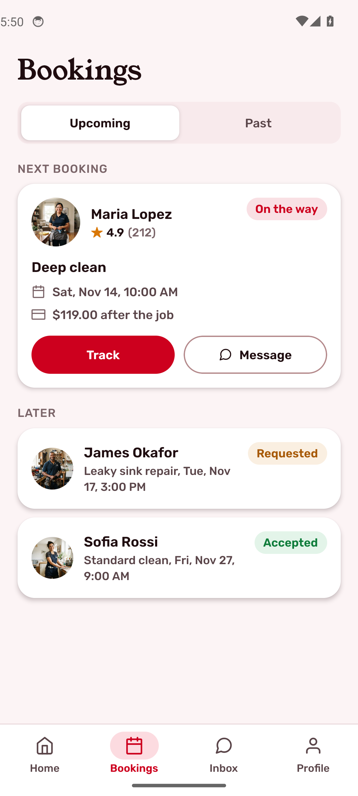 | 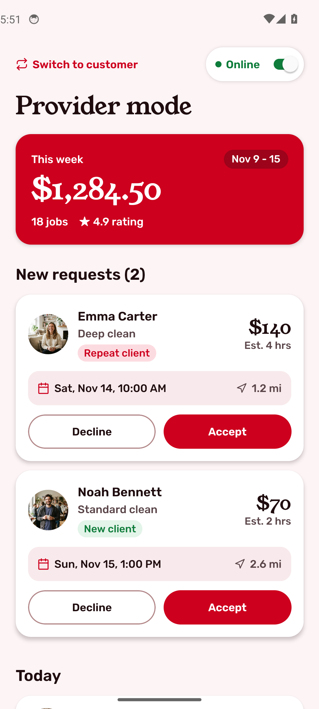 |

## What it shows

- **Discovery**: home with search, a promo card, six service categories and top-rated pros.
- **Compare pros**: category results with filter chips (available today, top rated, under $40/hr, eco products) and a best-match card, ranked by rating, then review count, then distance.
- **Provider profile**: verified badge, rating, jobs done and on-time rate, service packages with prices, recent work photos and a review.
- **Booking**: package, date strip and time slots (full slots disabled), address and notes for the pro.
- **Checkout**: package price, 5% service fee, promo code discount and total; the customer is charged only after the job is done.
- **Live job status**: requested, accepted, on the way, in progress, completed, with event times. Pro updates are simulated behind a tap.
- **Chat**: thread with the pro pinned to the booking, quick replies and simulated replies.
- **Bookings**: upcoming and past, plus a first-run empty state for new accounts.
- **Rate and tip** after the job.
- **Provider mode**: online toggle, weekly earnings, accept or decline new job requests, today's schedule.

Everything runs on mock data with no backend, payment, maps or push dependency, so every screen is demoable on a simulator.

## App flow

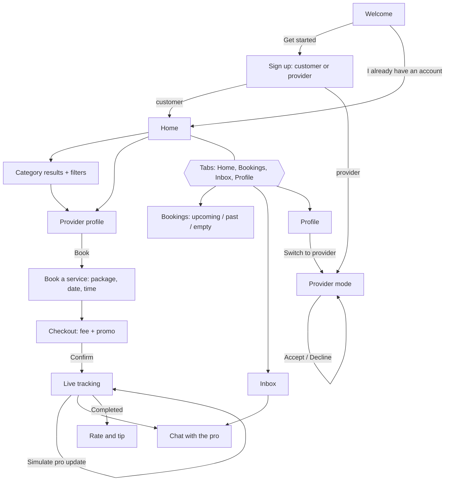

## Architecture

- **Expo SDK 58 + React Native + TypeScript**, file-based routing with Expo Router (`src/app`): a root stack with a four-tab group (Home, Bookings, Inbox, Profile).
- **Zustand** store (`src/store`) holds the booking draft, bookings and their lifecycle, chats, filters and provider-mode requests. The other side of the marketplace (the pro accepting, travelling, replying) is simulated in the store.
- **Pure logic with unit tests** (`src/logic`): checkout math (`quote`, fee, promo, tip) and the booking lifecycle (`advance`, timeline state, ranking and filters), tested with `node --test`.
- **Design tokens** (`src/theme/tokens.ts`) and shared components (`src/components`) follow the Stitch design in `design/`: crimson accent, Rubik for UI, Young Serif for display.
- All photos are bundled in `assets/images` (no remote URLs).

```
src/
  app/          screens (Expo Router)
  components/   tab bar, buttons, chips, cards, status chip, rating
  data/         models, seed data, image map
  logic/        pricing + booking rules (+ tests)
  store/        Zustand store
  theme/        design tokens
design/         Stitch screens (HTML + PNG), DESIGN.md, logo
```

## Run

```sh
npm ci
npx expo start          # press a for Android, i for iOS, w for web
npm test                # unit tests for pricing and booking rules
npm run typecheck
```
